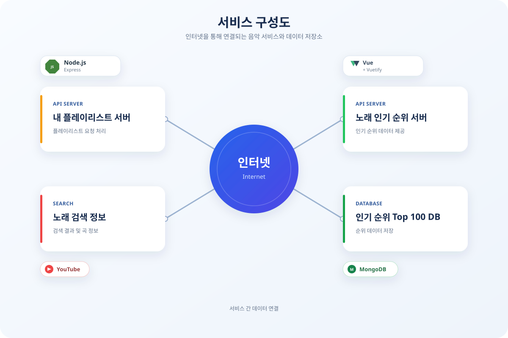

# 인기 탑 100위 & 플레이리스트
23년 종합 학술제 프로젝트

- 본 프로젝트는 Node.js 기반으로 노래를 즐겨 듣는 사람들을 위해 개인 플레이리스트 웹사이트를 개발하는 것을 목표로 합니다.

### 기능
<pre>
- 실시간 노래 인기 차트 Top 100 제공
- 플레이리스트에서 곡을 선택해 바로 재생
- 원하는 노래 검색
</pre>

### 개념적 모델링

 

---

 

### 서비스 이용 시나리오

 

---

 

### 🧾 README업데이트 이력
| 날짜 | 내용 |
|------|------|
| 2026-11-06 | README 설명 추가 |

 

---

 

### 🔗 참고 링크
- **아이디어붐:** [아이디어붐 바로가기](https://www.ideaboom.net/project/project/view?seq=1518&search_keyword=%EC%9C%A4%EC%8A%B9%EA%B7%BC=copy_link)  
